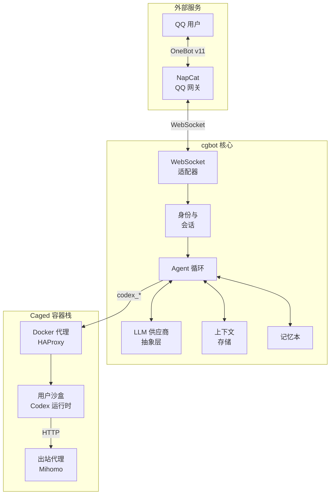

# cgbot

中文 | [English](./README.md)

以大模型为核心循环的 QQ 机器人框架,提供会话上下文管理、多代理架构和基于 Codex 的用户沙盒编程环境。

## 概览

**cgbot** 是一个围绕大语言模型(LLM)设计的 Python 聊天机器人框架。不同于传统的命令驱动机器人,cgbot 将 LLM 交互作为一等公民,参考 Codex 和 Oh My Pi 实现了完善的上下文预算、压缩和持久化策略。

### 主要特性

- **LLM 原生架构**:对话由 LLM 推理驱动,而非命令系统
- **统一用户身份**:跨平台身份系统(当前支持 QQ,计划支持微信)
- **上下文管理**:达到窗口 50% 容量或空闲 8 小时后自动压缩
- **回复即工具**:模型通过显式回复工具输出,可指定渠道
- **私聊与群聊**:独立逻辑路径,严格隐私隔离
- **Codex 集成**:为每个用户提供 Docker 沙盒,支持多代理编程任务
- **配置驱动**:基于 TOML 配置文件,无 WebUI
- **安全模型**:零信任沙盒,网关注入密钥,受控出站

### 架构



### 连接类型

- **QQ**(通过 [NapCat](https://github.com/NapNeko/NapCatQQ)):主要接口,使用 OneBot v11 反向 WebSocket
- **微信**(通过 OpenClaw):计划在未来版本中支持

## 快速开始

### 前置要求

- Python 3.12+
- [uv](https://github.com/astral-sh/uv) 包管理器
- 运行中的 [caged 容器栈](caged/README.md)(沙盒功能需要)
- LLM API 访问(参见[赞助商](#赞助商)了解免费选项)

### 安装

```bash
# 克隆仓库
git clone https://github.com/CubeGardenCosmos/cgbot.git
cd cgbot

# 安装依赖
uv sync

# 复制并编辑配置
cp config.example.toml config.toml
# 编辑 config.toml 填入你的设置
```

### 配置

参考 `config.example.toml` 了解详细配置选项。主要部分:

- `[napcat]`: NapCat WebSocket 连接
- `[provider]`: LLM 供应商设置(API 密钥在 secrets.toml 中)
  - 模板使用 Cicori AI 的 OpenAI/Responses 兼容端点(`api.cicori.com`)
  - 可通过修改 `base_url` 使用任何 OpenAI 兼容供应商
- `[persona]`: 角色卡配置(详见 `docs/reference/character-card.md`)
- `[agent]`: Agent 行为和推理档位
- `[storage]`: 会话持久化路径
- `[coding]`: Codex 沙盒集成

### 运行

```bash
# 开发模式
uv run python -m cgbot

# 指定密钥文件
uv run python -m cgbot --secrets secrets.toml
```

### 测试

```bash
# 运行单元测试
uv run pytest

# 包含集成测试(需要真实服务)
uv run pytest -m integration
```

## 部署

生产环境 Docker 部署:

1. 查看[部署指南](docs/reference/deploy.md)(唯一来源)
2. 搭建 [caged 容器栈](caged/README.md)
3. 按照部署指南配置网络和密钥
4. 使用 `deploy/docker-compose.yml` 和 `deploy/deploy.sh`

**重要**:参见 [AGENTS.md 部署规则](AGENTS.md#部署)了解授权要求和密钥处理。

参见 [`caged/README.md`](caged/README.md) 了解容器栈详情(Docker API 白名单代理、出站代理、沙盒镜像)。

语音(可选的 TTS/ASR 守护进程):见[语音服务部署参考](docs/reference/voice-services.md)与 [`voice-services/`](voice-services/README.md)。

## 安全模型

- **身份隔离**:私聊与记忆本和群聊完全隔离
- **回复即工具**:模型不能直接输出,必须调用回复工具
- **密钥引用**:凭据在网关注入,沙盒不可见
- **沙盒零信任**:无 docker.sock 访问,受控出站,独立用户卷
- **隐私规则**:用户私聊数据不会流入群聊上下文

## 赞助商

cgbot 由 [Cicori AI](https://api.cicori.com/) 赞助。

通过 GitHub 注册可获得每周 5 美元的 DeepSeek API 免费额度。

## 项目状态

**Alpha 阶段**:核心框架已实现(M1),私聊功能开发中(M2)。群聊(M3)、语音(M4)、完整 Codex 集成(M5)已规划。

参见 [MILESTONE.md](docs/MILESTONE.md) 和 [roadmaps](docs/roadmaps/) 了解详细状态。

## 参与贡献

参见 [CONTRIBUTING.md](CONTRIBUTING.md) 了解开发指南。

## 许可证

GPL-3.0-or-later License - 详见 [LICENSE](LICENSE)

## 文档

- [设计文档](docs/DESIGN.md)
- [架构与决策](docs/README.md)
- [协作规范](AGENTS.md)
- [部署参考](docs/reference/deploy.md)
- [沙盒镜像](docs/reference/sandbox-image.md)
