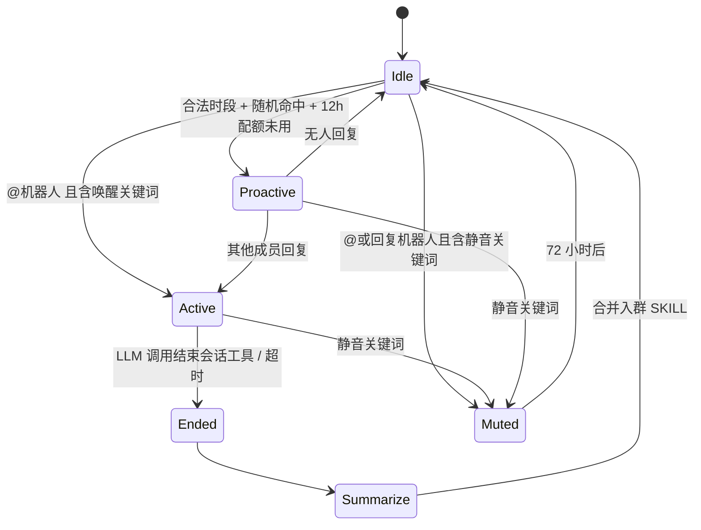
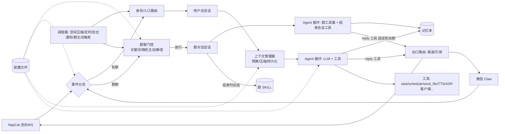

# 新机器人框架设计文档(草案)

> 状态:**探讨模式**,本文档随对话持续更新。
> 约定:`[已定]` = 用户明确表态;`[待定]` = 尚在讨论;`[推论]` = 我基于已定内容或调研的推断,需用户确认;`[调研]` = 来自对现有环境的只读观察。
> 当前阶段只写文档,不写代码,不改动任何现有系统(含 192.168.1.19 上的 AstraBot/NapCat/SoVITS/ASR)。AGENTS.md 待用户指令后再创建。

## 1. 背景

- 现状:192.168.1.19 上运行 AstraBot 实例承载 QQ 机器人。`[已定]` 它已无法满足需求。
- 决策:`[已定]` 新建一个机器人框架,替换 AstraBot。
- `[调研]` 现有部署(据 `~/dsh-docker-caged/HANDOFF.md`):`/home/klp/qqbot` 内为 NapCat + AstraBot(`soulter/astrbot`)的 docker-compose;调度中枢是自写插件 `astrbot_plugin_identity_helper`;另有 `agent_irc` 等插件。
- `[调研]` 本机(`/home/klp/cgbot` 所在机器,192.168.1.11)上有两个相关插件工程:`~/dsh-docker-caged/astrbot_plugin`(沙盒任务/计划/发图发文件)、`~/qqbot-to-omp-web/astrbot_plugin_omp_control`(OMP 任务控制)。`/home/klp/cgbot` 为空。
- `[已定]` 已有资产主要以 **AstraBot 插件**(Python)形式存在。**特别关注:SoVITS(TTS)与 ASR 推理服务器。**

## 2. 目标

1. `[已定]` **原生围绕大模型**:LLM 是核心循环,不是挂在命令/插件系统上的附属功能。
2. `[已定]` **上下文管理参考 Codex / Oh My Pi**:上下文是一等公民,有明确预算、压缩、持久化策略。
3. `[已定]` **无 WebUI,配置文件驱动**。
4. `[已定]` **Python** 实现。
5. `[已定]` **复用**已有框架与插件中合适的部分(见 §8)。
6. `[已定]` **接入目标**:NapCat(QQ,主要入口,**反向 WebSocket**);微信官方 OpenClaw **先不支持**,协议调研留档于 §12.1c。
7. `[已定]` **用户身份 + 多入口 + 单一总会话**(§4)。
8. `[已定]` **自动压缩**:上下文超限,或空闲 8 小时后主动压缩(§5)。
9. `[已定]` **回复是工具**:模型通过工具回复,而非直接输出文本(§6)。
10. `[已定]` **支持群聊**;**记忆本**记录用户相关信息,含群聊画像(§7)。

## 3. 非目标

- `[已定]` 不提供 WebUI。
- `[推论]` 不做多租户 SaaS 管理后台;配置变更 = 改文件 + 重载。

## 4. 核心概念:身份、入口、会话

| 术语 | 含义 |
|---|---|
| 用户 (User/Identity) | 框架内的身份,与平台账号解耦;会话与记忆本归属于用户。 |
| 入口 (Channel) | 用户的某个平台账号,如一个 QQ 号、一个微信 Claw 账号。 |
| 会话 (Session) | **私聊侧**用户的上下文载体。`[已定]` 每用户**一个总会话**。群聊不使用它(见 §7)。 |

- `[已定]` QQ 是主要入口:身份通过 QQ 入口创建。
- `[已定]` 身份创建后可**关联添加**微信入口;关联后共享同一总会话。**该功能随微信适配器一并后置,首期不做。**
- `[已定]` 私聊侧:不按入口拆分——每用户一个总会话。
- `[已定]` **私聊与群聊是两套完全不同的逻辑**(用户强调)。总会话属于私聊侧;群聊有独立的子系统(§7),`[推论]` **不进入任何用户的总会话**。
- `[待定]` 关联流程(配对码?);陌生人处理。

## 5. 上下文管理

### 5.1 已定的触发条件

- `[已定]` 上下文用量达到**供应商给定上下文窗口的 50%** → 自动压缩(§5.4)。
- `[已定]` **空闲 8 小时** 后压缩,**到点主动执行**(不等下一条消息;即需要调度器)。

### 5.2 参考设计要点(Codex / Oh My Pi,`[推论]`,待逐项确认)

- 会话以**追加式记录**持久化(消息、工具调用、压缩事件),可恢复。
- 压缩产物 = 摘要 + 保留的近期尾部;摘要作为新上下文起点。
- 压缩前的原始记录保留在日志中,只是不再送入模型。
- token 预算:`窗口 − 预留输出 − 预留压缩开销` 作为触发线。
- 工具输出需截断/落盘,避免单次撑爆上下文。

### 5.3 与记忆本的关系 `[推论]`

压缩摘要 = 短期连续性;记忆本 = 长期事实。主动压缩(8h 空闲)是把当日要点沉淀进记忆本的天然时机。`[待定]` 是否这样设计。

### 5.4 压缩与模型档位(第五轮 `[已定]`)

- 窗口:取**一个窗口**,数值来自供应商抽象层所报告的该模型上下文窗口;**用量达 50% 即压缩**。
- 单一模型供应商,但**供应商必须抽象成独立层维护**(窗口大小、推理档位、计费/限流、请求格式都封装在内),换供应商只改该层与配置。
- 推理档位按用途区分(进配置文件):

| 用途 | 推理程度 |
|---|---|
| 压缩摘要 | low |
| 日常私聊 | high |
| 任务规划 | Max |

- `[待定]` 群聊轮次用哪档;群会话总结用哪档(`[推论]` 同摘要用 low)。
- `[待定]` 保留尾部的规则;摘要提示词放配置;主动压缩时用户恰好来消息的并发处理。
- `[推论]` "窗口 50%"是否已扣除预留输出/系统提示/工具定义的占用,需在设计细化时明确(建议按"当前请求总 token / 窗口"计算)。

## 6. 回复即工具

- `[已定]` 模型**不直接输出文本给用户**,而是调用工具回复。
- `[已定]` 回复工具可指定:**回复到哪个渠道(入口)**、甚至**回复哪一句话(引用)**。
- `[已定]` 默认回复到消息来源;**通知类**消息发送到用户**最常用的入口**(依据每日统计)。
- `[推论]` 含义:
  - 模型的普通文本输出视为内部思考/不外发;不调用回复工具 = 保持沉默(群聊里天然支持"不插话")。
  - 消息进入上下文时需带可引用的**消息 ID**与**来源入口**标注,模型才能选择渠道/引用对象。
  - 一轮内可多次调用回复工具(分段、多渠道)。
  - 需要把"沉默"与"出错"区分清楚。
- `[调研]` 现有 `astrbot_plugin_dsh_caged` 已有 `send_image` / `send_file`(按事件发送者身份发送,不接受用户 ID 参数);新框架应沿用"身份取自事件,模型不能指定其他用户"的约束。
- `[待定]` 通知链路:后台事件(任务完成、定时)如何触发模型一轮(现有做法是 AstraBot 的 `CronMessageEvent` 合成事件;新框架需要原生的"系统事件入队"机制)。每日统计的数据来源与口径(见 §7、§12)。

## 7. 记忆本与群聊

- `[已定]` 群聊支持。最初表述为"依旧按现有插件设定";用户随后在第三轮给出了新的群聊规则(§7.2),**触发相关部分以 §7.2 为准**,旧设定见 §11.6。
- `[已定]` 机器人有一个**记忆本**,记录用户相关信息,**包含群聊画像总结**:总结用户的发言特征与话题。
- `[已定]` **隐私规则:不得把用户的隐私(来自私聊/记忆本)反向带到群聊。**
- `[推论]` 强制手段不应只靠提示词:记忆条目需带**可见域**标签(private / group:<id> / public),群聊轮次只注入可见域内的条目。`[待定]`
- `[调研]` 现有:identity_helper 的 `_SUBAGENT_DISABLED_GROUPS`(某群不触发 LLM 回复,但仍收集历史、响应显式命令)。该设定是否延续 `[待定]`。
- `[调研]` **记忆本现状:仅有设计文档,没有实现**;群聊画像现有等价物是"群技能卡"(§11.7)。因此记忆本在新框架中是**新建**,不是迁移。

### 7.1 总原则:私聊与群聊是两套独立逻辑

`[已定]` 两者完全不同。下表是我据此整理的对照,标 `[推论]` 处需用户确认。

| 维度 | 私聊 | 群聊 |
|---|---|---|
| 会话单位 | 用户总会话(跨入口,长期存在) | **群对话会话**:有起点、有终点,按群独立 `[推论]` |
| 谁决定是否进 LLM | 用户消息即触发(经防抖) | **确定性门控**(@+关键词 / 随机主动 / 静音),不通过则不进 LLM |
| 沉默 | 一般都会回 | 默认沉默;只有门控放行才可能说话 |
| 上下文维护 | 追加日志 + 阈值/空闲 8h 压缩(§5) | 会话结束时总结 → 群 SKILL;是否也走 8h 压缩 `[待定]` |
| 持久化产物 | 记忆本 | **群 SKILL**(每群一份)+ 记忆本中的用户群聊画像 |
| 回复 | `reply` 工具,可选渠道、可引用 | 同一工具,渠道固定为该群,可引用 `[推论]` |
| 隐私域 | 可读私聊记忆 | 只读群可见域;**绝不带入私聊内容** |

### 7.2 群聊规则(用户 2026-10-30 第三轮,均为 `[已定]`)

1. **唤醒**:机器人只会被 **@** 唤醒,且 @ 的消息**必须带关键词**才算唤醒;缺一不可。
2. **随机主动回话**(除此之外不会主动开口):
   - **睡眠时间 00:00–08:00 不触发**;合法时间为 08:00–24:00。
   - **每群 12 小时内最多触发一次**。
   - 触发是**随机**的:合法时间内每小时命中概率 p = 1/12,命中后该群冷却 12 小时(§12.1)。
3. **主动回话后的续聊**:只有**其他群成员回复**了,才继续回话;无人回复则不再说话。
4. **闭嘴**:有人 @ 或回复机器人后,说了"闭嘴"等关键词 → **该群 72 小时内禁止检查群聊,不记录、不传给 LLM**。睡眠时段 00:00–08:00 群聊子系统整体静默,@ 也不响应(§12.1)。
5. **结束会话工具**:LLM 可在群聊中**主动调用**该工具,中断当前对话。
6. **总结与群 SKILL**:对**自己处理过的**群聊会话进行总结,形成**持久化的群聊 SKILL**。

### 7.3 由群聊规则推出的设计含义(`[推论]`)

- 门控是 **LLM 之前的确定性代码 + 配置**,不靠提示词。唤醒关键词、静音关键词、睡眠时段、配额、静音时长全部进配置文件。
- 需要**持久化的每群状态**:`last_proactive_at`、`muted_until`、当前会话状态与起止时间。重启不可丢,否则 12h 配额与 72h 静音会失效。
- 主动回话需要调度器,以及触发那一刻可读的**近期群消息缓冲**;静音期间不检查、不缓冲(是否仍落盘记录 `[待定]`)。
- 群对话会话生命周期:开始(@+关键词 / 主动)→ 续(仅限规则 3 / 对话参与者)→ 结束(结束工具 / 闭嘴 / 超时 `[待定]` / 无人回复)→ 总结 → 合并入群 SKILL。
- **群 SKILL 取代现有"每晚 23:55 对全天消息提炼的技能卡"**:现有是批处理全部消息,新规则是只总结"自己处理过的会话"。格式沿用 JSON 卡还是 SKILL.md 风格 `[待定]`。
- 本规则**取代** §11.6 中旧的"35 秒活跃窗口 / 5% 插话 / 25% 潜水表情 / 无关键词的 @ 或唤醒"。防抖、句子拆分、引用等旧设定未被提及,暂视为保留 `[待定]`。

## 8. 复用清单

| 资产 | 位置 | 复用方式 | 约束 |
|---|---|---|---|
| SoVITS 推理服务 | 192.168.1.19 `/home/klp/sovits_service`,TCP 10096 + UDS | 复制现有插件 `socket_client.py` 的线协议为新框架 `SoVITSClient` | `[已定]` **严禁修改**服务端;不重启、不改配置、不改 venv |
| ASR 推理服务(SenseVoice) | 192.168.1.19 `/home/klp/funasr_service`,TCP 10095 + UDS | 同上,`FunASRClient` | 同上 |
| 人设/群聊/私聊提示词 | identity_helper 的 Python 常量 | 移植文本;触发/路由逻辑按新架构重写 | 取舍待定 |
| 群技能卡(群聊画像雏形) | group_history_summarizer | 移植 merge/format/parse 逻辑与提示词,作为画像 v0 | 已知缺陷见 §11.7 |
| 消息防抖 | identity_helper | 移植"缓冲 + 延长 + 上限"模式 | — |
| 群消息历史库 `group_messages` 及查询 | group_history_summarizer | 可移植 SQL 与表结构;数据是否导入新库 `[待定]` | — |
| dsh_caged | 本机 `~/dsh-docker-caged`,manager REST/WS | 对接 manager API;AstraBot 侧工具层重写为新框架工具 | manager/沙盒本体不动 |
| omp_control | 本机 `~/qqbot-to-omp-web` | 按工具移植,对接 ompweb | 同上 |
| 表情包 / 梗百科 / 搜索 / 视频抽帧 / 群日报 / 新闻订阅 | 上游或自写插件 | 是否保留、如何保留 `[待定]` | — |

- `[已定]` 原则:对 SoVITS/ASR **只写客户端,不碰服务端**。

## 9. 接入层

- NapCat:`[已定]` **反向 WebSocket**(NapCat 作 WS 客户端,新框架作 WS 服务端)。现有配置:`ws://astrbot:6199/ws`,`messagePostFormat: array`,心跳 30s,重连 30s,已配置 token(值不记录)。AstrBot 一侧的平台配置在 root 600 的 `cmd_config.json`,未读取。
- 微信:`[已定]` **微信官方 OpenClaw**(Claw),**先不支持**(后置)。`[调研]` 协议与参考实现见 §12.1c。首期适配层只需 NapCat,但内部消息模型与"入口"抽象仍要为多入口预留。
- `[推论]` 适配器只做:平台事件 → 统一内部消息;统一内部消息/动作 → 平台调用。不含业务与 LLM 逻辑。
- `[推论]` 需要统一的内部消息模型:消息 ID、来源入口、发送者平台 ID、群/私聊、段(文本/图片/语音/文件/引用/@)。

## 10. 模块划分(初稿,`[推论]`)

世界信号新闻推送(`[已定]`,由 `src/cgbot/news/` 承接旧 AstrBot 插件的每日推送):`NewsStore`(订阅与发送台账,`news.sqlite`)、`NewsPusher`(轮询推送,`push_time` 起推送,未完成则等到 `give_up_hour`)、`delivery` 读取与切片(只读消费 `output_dir`,不触发生成)。订阅与取数仅经私聊的 `news_subscribe` / `news_fetch` 工具,群聊不注册。部署待验证,见运行手册 §10。

## 11. 现有环境调研(只读,2026-10-30)

### 11.1 部署与规模

- `/home/klp/qqbot`:NapCat(`mlikiowa/napcat-docker`)+ AstrBot(`soulter/astrbot`,版本 `[推论]` 约 4.28–4.29)。
- **所有容器(napcat、astrbot、news-rsshub、dsh-*)当前为 Paused**,astrbot 自 2026-10-28T17:10Z,原因未知;调研未做任何恢复。
- 规模(下限,WAL 未计入):4 个群;群消息 14 天表 2723 条/60 个发言人;私聊用户约 5 个;LLM 调用累计 960 次,唯一 provider 为 `deepseek-v4.1-flash`(内部 OpenAI 兼容网关);平台事件 aiocqhttp 2907、cron 271、`weixin_oc` 18、webchat 9。`[推论]` 规模很小,单进程 asyncio 足够。
- 数据:`data_v4.db`(conversations 11、platform_message_history 3001…)、`group_history_14d.db`(`group_messages`)、`group_skills/<gid>.json`、`group_reports/`、`plugin_data/`。

### 11.2 NapCat 与 OneBot 依赖

- NapCat 仅配置了一个 WS 客户端;HTTP/WS 服务端均为空。
- 现有插件实际用到:群/私聊消息事件;notice 仅 `poke`;未依赖 request、撤回、入群事件。
- 消息段:Plain、At、Face、Reply、Image、Record、File、Forward/Nodes、Video,`base64://` 文件段。
- OneBot 动作:`get_forward_msg`、`get_msg`、`upload_group_file`/`upload_private_file`、`set_msg_emoji_like`、`send_group_msg`、`get_group_list`。
- `[推论]` 新适配器的最小集合即以上;NapCat 的 `websocketClients` 是数组,可**新增**第二条指向新框架做并行试运行而不动现有条目(未验证 NapCat 对多客户端的行为)。
- 安全观察:NapCat WebUI 监听 `0.0.0.0:6099`、无访问控制、无 2FA,token 明文在 644 的 compose 文件中。

### 11.3 语音服务(不改动)

- **线协议**:4 字节大端长度 + UTF-8 JSON,上限 50MB,长连接,无 HTTP/WS/鉴权/TLS/流式;每进程单模型、`asyncio.Lock` 串行。
- **SoVITS**:动作 `ping|health|status|tts`。音色**固定**(单一参考音频与提示文本,`character` 参数被忽略);返回 **WAV 文件路径**(`host_path`/`container_path`),不返回音频字节;文件永不清理;延迟约 1.6–3.3 倍实时。
- **ASR**:动作 `ping|transcribe`,入参 `audio_b64` 或 `container_path`;返回 `text`/`raw_text`;0.3–1.5 s/条。
- **GPU**:GeForce 830M 约 2GB,两服务合计占约 1.5GB,余约 535MB,无跨进程协调;SoVITS 与 ASR 共用同一 venv。
- 现有插件的 `socket_client.py`(约 100–115 行,仅 asyncio/json/base64)是纯线协议客户端,可复制。
- **对新框架的约束 `[推论]`**:
  - TTS 只给主机文件路径 → 新框架必须能读到该路径,即**与 SoVITS 同机部署**(192.168.1.19)或共享挂载。
  - 现有"WAV→silk"依赖 AstrBot 内部函数,"QQ 语音→WAV"同理;新框架需自备转换(ffmpeg / silk 编码),或验证 NapCat 可直接收 WAV。
  - 现有语音触发逻辑(`smart`:私聊语音进→语音出、关键词抑制、会话级开关)在新框架中应改为"回复工具的发送形式"由模型决定。

### 11.4 现有插件(13 个)

- 自写:`agent_irc`、`dsh_caged`、`funasr`、`group_history_summarizer`、`identity_helper`、`news_collector`、`omp_control`、`sovits`、`video_inspector`。
- 上游:`astrbot_all_search`、`memewiki`、`qq_group_daily_analysis`(含本地补丁)、`meme_manager`。

### 11.5 identity_helper:现有身份与路由

- 三个 agent 经内存 IRC 总线通信:main_agent / group_subagent / private_subagent;群聊要引用私聊内容时走 `REQUEST_PRIVATE_SUMMARY`。
- 身份:`MASTER_QQ` 硬编码;角色 `group_at`、`group_chime_in`、`private`;人设为"深海鲸鱼娘",提示词是 `main.py` 中的字符串常量。
- 工具白名单按子串匹配;OMP/DSH 的私有工具仅给私聊 agent。

### 11.6 现有群聊设定(旧行为;其中触发规则已被 §7.2 取代)

- 触发:@/唤醒;**35 秒活跃对话窗口**,窗口内最多再续 2 轮;**5% 随机插话**(3–15 字,冷却 60 秒);潜水时 25% 概率仅用表情回应。(`[已被取代]` 见 §7.2)
- 某群(`977405321`)禁用 LLM 回复,但仍收集历史、响应显式命令;`/群聊 开启|暂停` 仅主人可用。
- **防抖**:群聊按(群,发言人)缓冲,初始 5–8 秒,后续每条延长 3–5 秒,上限 11 秒,空格拼接;私聊初始 1.8 秒、上限 4 秒,且等待上一轮运行结束(最长 240 秒),换行拼接。
- 上下文注入:近期群历史摘要、群技能卡(群聊画像)、与该用户相关的群活动(15 条)、转发聊天记录、私聊"模糊摘要"。
- 回复现状:直接文本输出 + 装饰器 —— 按句拆分(≤18 字整句保留)、`[Face:N]` 表情标签(20% 抑制、每条最多一个)、群消息自动 `Reply` 引用(语音除外)、独立工具 `react_message_with_emoji`。**没有"选渠道/选引用对象"的能力,这是新需求。**

### 11.7 记忆本、群聊画像、每日统计

- **记忆本:未实现**。仅有 4 份设计文档(`qq_group_daily_analysis/docs/group_memory_prd.md` 等,PRD v0.2 811 行);`MemoryStore` 未实现。`[待定]` 是否读取并采纳这些文档。
- **群聊画像现有等价物 = 群技能卡** `group_skills/<gid>.json`:`atmosphere`(语气/常见话题/摘要)、`memes`、`members`(昵称/角色/习惯)、`rules`。每晚 23:55 对当日最多 4000 条/35000 字提炼并与旧卡合并(话题 8、梗 15、成员 12、规则 6)。卡内 `memes` 不再渲染进群提示词;每次总结的梗另写入按群隔离的词条表 `meme.sqlite`(`MemeStore`,每群最多 300 条,`大肥鱼: 解释` 拆为词条与解释),由 `meme_lookup` 工具按需查询(群会话只查本群,私聊可查全部群)。
  - 已知缺陷:成员上限按**插入顺序**而非活跃度截断;`query_user_related_group_records` 用子串 `LIKE` 匹配,有误匹配可能。
- **隐私机制现状**:提示词规则 + 私聊"模糊摘要"(40–80 字,无姓名/金额/原话),仅在群里提到私聊时才取。风险:主侧会读取原始私聊库。
- **每日统计**:`qq_group_daily_analysis` 的 `GroupStatistics`,每天 09:00 在**群内**发布,没有私聊通知通路。**"用户最常用入口"现无任何实现,是新需求**。

### 11.8 可移植 vs 与 AstrBot 耦合

- 可移植:全部提示词;句子拆分/Face/Reply 规则;防抖模式;技能卡 merge/format/parse;`group_messages` 的 SQL;统计领域服务;总结器逻辑(去掉 provider 耦合)。
- 耦合(新框架须重写为原生原语):`Star/Context`、事件钩子、`ProviderRequest`、消息组件、`cron_manager`、插件 KV、`_ACTIVE_AGENT_RUNNERS`、`CronMessageEvent` 合成事件。

### 11.9 观察到的问题(留档)

- 容器全部 Paused;`event_loop_watchdog.log` 记录过 4694 s、3224 s 的事件循环卡顿,`[推论]` 嫌疑为 `omp_control` 的 `_watch_loop`。
- `group_history_summarizer/summarizer.py` **硬编码了 bearer token 与内部端点**(值未记录于此)——应轮换并迁入配置;新框架不得复制此做法。
- `qq_group_daily_analysis` 的本地补丁硬编码管理员 QQ;`identity_helper` 下有 7 份 `main.py.bak*`。
- 语音服务无鉴权、监听 `0.0.0.0`、UDS 权限 666;FunASR 的 `container_path` 未做路径约束(`[推论]` 可被 `..` 绕出映射目录)。服务端不得改,所以新框架只应通过内网/UDS 访问,并不对外转发路径参数。

## 12. 决议与待回答

### 12.1 已决议(第四轮)

- `[已定]` 群聊发言人画像:群会话结束总结时,同时提炼各发言人的"群聊画像"写入记忆本,标记为**群可见域**。
- `[已定]` 随机主动回话:合法时间 08:00–24:00 内,每小时命中概率 p = 1/12;命中后该群冷却 12 小时。
- `[已定]` 睡眠时间 00:00–08:00:**@ 唤醒也不工作**(整个群聊子系统在此时段静默,不只是主动回话)。
- `[已定]` 静音 72 小时内:**不记录**群消息(不落盘、不缓冲、不传给 LLM)。
- `[已定]` 切换策略(**取代此前"并行"表述**):**旧 AstraBot 直接不拉起,只跑新框架**。NapCat 需运行,并**新增**一条反向 WS 指向新框架(现有指向 `astrbot:6199` 的条目无对端,会按 30 秒间隔重连失败,无害)。
- `[已定]` 测试范围:**仅好友,以及配置文件里固定写死的群聊**;具体群号等真实测试时再定。
- `[已定]` 微信接口:**微信官方 OpenClaw**(即 Claw);AstraBot 里的 `weixin_oc` 是它的适配,可作参考实现。接口文档仍需用户提供或由我检索。
- `[已定]` 模型:**单一供应商**,但供应商抽象独立(§5.4)。
- `[已定]` 部署位置:**暂不讨论**。
- `[已定]` 群聊轮次推理档位:**low**(群会话总结同按 low `[推论]`)。
- `[已定]` 记忆本采用"**可见域标签 + 注入时过滤**"作为硬约束;允许只读查看 `weixin_oc` 适配源码与 4 份记忆设计文档(调研进行中,结果补入 §11)。
- `[已定]` "任务规划"(DSH `task` 首次调用时的规划)**将重做**,单独讨论,暂不设计。
- `[已定]` 微信(OpenClaw)入口**只做私聊**,不支持也不需要支持群聊。因此群聊子系统(§7.2)只对接 NapCat/QQ;微信适配器无需群相关事件与门控。
- `[已定]` 微信(OpenClaw)**先不支持**。首期只有 QQ 入口;关联微信、微信通知回退等一并后置。

### 12.1b 记忆设计文档调研结论(只读,4 份文档)

- 4 份文档(PRD v0.2、总提案、Phase 1 提案、可行性复盘)只描述设计,**没有任何实现**;没有抽取提示词;**完全没有可见性域、私聊记忆、用户 opt-out 机制**——这些要由新框架自己设计。
- 数据模型:`GroupProfile`(摘要/语气/常见话题/核心成员)、`MemberProfileLite`(群内每用户一条,键 `{scope}:{user}`)、`Episode`(时间段摘要+关键词+参与者+importance+过期时间)、`MemorySnapshot`。作用域键 `{platform}:GroupMessage:{group_id}`;不做跨群统一画像。
- 读路径:按 keyword 0.35 / 参与者 0.20 / 新近 0.20 / importance 0.15 / confidence 0.10 排序,top-k(episode 4、成员 5),低置信度过滤(0.45);提示规则"当前事实优先、记忆只作背景、低置信措辞保守"。
- 写入与清理:写入 best-effort 挂在主流程之后;每日 compact(删过期 episode、限量、降低久未更新画像的置信度)、每周重建快照。Phase 1 episode 保留 21 天(总提案 30)。
- 隐私:写入前过滤电话/邮箱/地址;禁止心理诊断、政治/宗教/健康推断;`role_tags` 仅限群内行为角色。
- 文档内部冲突:`max_episode_per_group` 200/120、保留天数 30/21、成员 top-k 6/5、`max_member_profile_count` 300/200;batch 侧抽取用规则还是 LLM 未定。
- **采纳建议 `[推论]`**:采用作用域键、索引+实体存储、best-effort 写入、预算化检索、定时清理、功能开关与降级模式;每条记忆新增 `domain ∈ {private, group:<id>}`、`subject_user`、`source_domain`,检索时**先按域过滤再排序**,群域注入绝不含私聊派生内容;群 SKILL 做成版本化、可人工覆盖的派生产物;成员画像只保留有信号支撑的群内行为标签;存储用 SQLite 而非 KV(新框架无 KV),锁为单进程 asyncio 锁即可。

### 12.1c 微信 OpenClaw 协议调研结论(只读)

- 基础:API `https://ilinkai.weixin.qq.com`,CDN `https://novac2c.cdn.weixin.qq.com/c2c`;JSON POST,头 `AuthorizationType: ilink_bot_token` + `Authorization: Bearer <token>` + 每请求随机 `X-WECHAT-UIN`。**协议无官方规格文档**,最接近的参考是腾讯官方 npm 包 `@tencent-weixin/openclaw-weixin` 2.4.10(MIT)与 AstrBot `weixin_oc` 适配(`astrbot/core/platform/sources/weixin_oc/`,client 约 260 行,adapter 1814 行)。
- 接口:`get_bot_qrcode`(扫码登录)、`get_qrcode_status`(长轮询)、`getupdates`(35 秒长轮询,游标 `get_updates_buf`)、`sendmessage`、`getconfig`+`sendtyping`(输入中)、`getuploadurl`(媒体上传)。官方另有 `notifystart/notifystop`。
- 消息:文本/图片/语音(SILK,可带服务端转写 `voice_item.text`)/文件/视频;引用 `ref_msg`;媒体走 AES-128-ECB 加密 CDN。
- **只支持私聊**,官方包也是 `groupPolicy: disabled`、DM 配对(`pairing`)策略。
- **主动推送**:每次发送需要 `context_token`(来自用户最近一条入站消息,按用户保存)。AstraBot 在没有 token 时**直接跳过发送**;官方包缺 token 时仍会发出但服务端是否接受**未验证**。`[推论]` 即"通知走最常用入口"对微信入口不一定可行,需实测。
- 必须持久化:`bot_token`、`account_id`、`base_url`、`get_updates_buf`、每用户 `context_token`。错误码 `-14`(token 失效):官方暂停 60 分钟,AstraBot 清空并要求重新扫码。
- AstrBot 适配的缺口(新实现应以官方为准):未处理 `scaned/need_verifycode/scaned_but_redirect/binded_redirect`;忽略服务端 `longpolling_timeout_ms`;二维码经第三方 `api.qrserver.com` 生成(泄露登录链接,应本地生成);超时默认值互相冲突。
- 可复用:`weixin_oc_client.py` 基本是纯 aiohttp + AES,可直接提取;依赖 `aiohttp`、`pycryptodome`。SILK 解码需自备。另有非官方 Python 异步客户端 `weixin-ilink-client`(PyPI)可参考。
- 社区协议文档:`hao-ji-xing/openclaw-weixin`、`SiverKing/weixin-ClawBot-API`(仅供对照,未验证)。
### 12.2 切换带来的约束(`[推论]`)

- 旧框架不拉起 → **没有重复回复风险**,不再需要旧框架避让;但新框架仍应有**服务范围白名单**(好友 + 固定群),范围外事件一律丢弃。
- **与之前"旧框架继续做群聊分析与新闻订阅"冲突**:旧框架不运行期间,这两项**暂停**。试运行结束后是恢复旧框架、还是迁入新框架,`[待定]`。新闻订阅已由新框架 `news` 模块实现(见 §10),旧插件是否停用待部署验证。
- 测试期间 NapCat 容器需要运行;其 compose 里 `MODE=astrbot`、WS 目标为 `astrbot:6199`,新条目需 NapCat 配置变更——**这是对现有部署的改动,须用户亲自或明确授权后才做**,我不会动。
- SoVITS/ASR 只有新框架使用:服务端串行加锁,新框架应控制并发并设置合理超时(现有 30 秒小于长句合成耗时)。
- 旧框架容器当前 Paused,保持不动即可。

### 12.3 仍待回答

1. **每日统计与"最常用入口"**:口径按近 N 天消息数?统计存哪、谁来写?(现有没有这个功能。)
2. **记忆本**:是否让我读取那 4 份记忆设计文档作为输入?"可见域标签 + 注入时过滤"作为硬约束可以吗?
3. **OpenClaw 文档**:微信后置,暂不需要。
4. **现有功能取舍**:表情包、梗百科、搜索、视频抽帧、DSH 任务、OMP 控制——哪些要在新框架保留?
5. **任务规划**:将重做,另行讨论(§13.3)。
6. **群聊推理档位**:已定 low。
7. **"其他参与者回复了"的判定**:引用机器人那条、@机器人,还是任意后续发言?多久无人回复算结束?续聊期间是否不再要求 @+关键词?(我理解不再要求。)
8. **闭嘴**:关键词表?任何群成员都能触发吗?(条件是"@ 或回复机器人的消息里带关键词"。)
9. **群会话结束**:除结束会话工具与闭嘴外,是否要超时与最大轮数?
10. **群 SKILL**:沿用 JSON 卡,还是 SKILL.md 风格?未被机器人处理的群消息(非静音期)是否缓冲,供主动回话看上下文?
11. **关键词**:唤醒/静音关键词初始列表(放配置文件)。

## 13. Agent 行为设计(私聊 subagent)

### 13.1 总体(第七轮)

- `[已定]` 私聊 subagent **允许用户关联一个 Coding Agent**,并**默认自带一个 Coding Agent**,用于**数据采集与信息总结**。
- 群聊 subagent 的行为见 §7,与此处完全不同。

### 13.2 私聊通用行为(均 `[已定]`)

1. **用户正在输入中时,不请求 LLM 后端。**
2. **用户停止输入状态后 5 秒**,才开始请求。
3. **请求期间用户又发来新消息**,而 agent 已经调用工具发出了新的对话时:**把新消息作为工具的执行结果带给 agent**(而不是另起一轮或中止当前轮)。

`[推论]` 细则,待确认:

- **输入状态来源 `[已查证]`**:NapCat 4.18.41 会通过 OneBot 通知推送:`{"post_type":"notice","notice_type":"notify","sub_type":"input_status","user_id":<qq>,"group_id":0,"event_type":<int>,"status_text":"对方正在输入..."|""}`。仅私聊(`group_id` 恒为 0);经反向 WS 下发,**无需额外配置开关**。完整结论见 §13.6。
- **计时 `[推论]`**:请求发出时刻 = max(最后一条消息时间, 最后一次"正在输入"推送时间) + 5 秒;期间再来消息或再次推送则重置。**NapCat 没有"停止输入"事件**,"停止"只能靠"一段时间没有再推送"推断,所以 5 秒要从**最后一次"正在输入"推送**起算。日志显示推送约每 3–5 秒一次,且空文本推送会穿插在输入过程中,因此**不能把空文本当作停止**。仍需**最长等待上限**(数值 `[待定]`)。
- **取代旧防抖**:旧设定是私聊 1.8 秒起、上限 4 秒、并等待上一轮结束(最长 240 秒)后以换行合并(§11.6)。新规则以此为准。
- **新消息注入**:agent 已调用过工具时,下一次工具结果里附上"用户在此期间又发来:……"(带消息 ID,可被回复工具引用)。多条合并。这相当于对运行中的 agent 做 steering。
- `[已定]` **边界**:若本轮 agent **一个工具都没调用**,期间到达的新消息**直接打断**当前轮(中止进行中的 LLM 请求),新消息与已有消息合并后重新开一轮。
- 输入状态是 QQ 侧特性;微信后置,不涉及。

### 13.3 Codex 任务子代理(替代 DSH)

`[已定]`:

- 任务由 **Codex** 执行。设计与现有 DSH-caged 类似,**只是把 DSH 的位置换成 Codex**。
- 自带**插件、SKILLS 和内置的一整套软件包**(预装进镜像)。
- **默认 YOLO 模式**启动,并**作为服务器工作**(常驻,而非一次性命令)。
- **用户的 agent 可以管理会话**。
- 任务子代理可以**创建 Codex 的子代理**,并可使用 **Playwright**。
- "任务规划"(原 DSH 首次调用时的规划)将**重做**,后续单独讨论。

`[推论]` 含义与风险,待确认:

- `[已查证]` "作为服务器"即 Codex **app-server**(JSON-RPC 2.0,支持 stdio / WebSocket / unix socket),详见 §13.6。
- **YOLO 的安全边界必须由外层容器给**:沿用 DSH-caged 的零信任铁律——沙盒不挂 docker.sock、不可见真实密钥、模型请求经 gateway 注入密钥、egress 受控、每用户独立卷与主目录。
- `[已定]` **Codex 的模型请求走沙盒的 gateway**(沿用 DSH-caged 的密钥隔离)。**上游服务器必须原生支持 Responses API;gateway 不做协议翻译**,只做令牌校验、真实密钥注入、流式透传(必要时调整路径/头部)。需要翻译的话由上游自己处理。单一供应商决议不变。
- **可复用**:dsh-docker-caged 的 manager(任务注册表、计划任务、提问/回答、文件与图片回传)、gateway、egress、镜像分层与用户卷布局。**需替换**:镜像里的 DSH、`dsh-plugin-bot-bridge`(→ Codex 侧的桥接,形态如 MCP server 或 skill)。
- **会话管理工具**可参照 `omp_control` 的集合(列表、创建、续接、peek、steer、stop、compact、answer),`[待定]` 取舍。

### 13.4 默认 Coding Agent 与用户关联的 Coding Agent

- 默认:内置于每个用户的沙盒,用于**数据采集与信息总结**(`[推论]` 例如新闻采集一类)。
- `[已定]` 用户可再关联自己的 Coding Agent,**包括 ompweb(OMP)**,且**连接要简单**。`[推论]` 现有 `omp_add` 需要把 ompweb 密码经过 LLM 上下文,新设计应改为通过配置文件或带外命令录入,密码不进模型上下文;连接后以会话管理工具操作。

### 13.5 待答问题

1. `[已定]` **输入停止判定**:按"最后一次正在输入推送后 5 秒",不放宽。
2. `[已定]` **最长等待上限**:**没有上限**,一直"输入中"就一直等。(因为"停止"本身是靠"不再有推送"推断的,推送一停 5 秒后即发起请求。)
3. `[已定]` **关联 Coding Agent 的录入方式**:**按现有录入流程**(`omp_add` 式,私聊中提供主机/端口/密码/别名)。ompweb 多在内网访问,不担心凭据泄露。`[推论]` 这取代了此前"密码不进模型上下文"的建议。
4. `[已定]` **默认 Coding Agent**:用户可用它做任何事,"数据采集与信息总结"只是举例(用户自己常用来处理股票和经济数据)。不绑定新闻采集。
5. `[已定]` **会话管理**:见 §13.7 决议。
6. `[已定]` **回报通路**:沿用 `report_progress` 风格的桥接,**并扩展为可发送较大的二进制文件,单文件上限 512MB**。
7. `[已定]` **子代理**:Codex 侧的 subagent **不做限制**(不设 `max_depth`/并发子线程上限作为框架约束);限制加在**用户**层面——默认**每个用户 4 个并发** Codex 会话/任务,当上游**频繁触发 429 或故障**时**降到 1 个**。
8. `[已定]` **Playwright 登录态必须持久化**(每用户独立,置于其主目录,跨容器重建保留)。
9. `[已定]` **gateway 不翻译**:上游必须支持 Responses(见 §13.6 更正)。

### 13.6 只读调研结论(2026-10-30)

**NapCat 输入状态**(NapCat core 4.18.41,上游 `NapNeko/NapCatQQ`)

- 日志格式:`[Notice] [输入状态] <uin> 对方正在输入...` 或空文本;近 3 天 283 条,其中输入 126、空 157;无显式开始/结束标记。
- 内核推送 `onInputStatusPush({chatType, eventType, fromUin, interval, showTime, statusText, ...})` → OneBot 事件 `OB11InputStatusEvent`(源码带 TODO"需要做一些过滤")。
- **无"停止"事件,无心跳/过期机制**,NapCat 原样转发;客户端需自备超时。`event_type` 取值含义源码未记载。
- **无查询接口**(`nc_get_user_status` 是在线状态,不是输入状态)。
- **有发送接口** `set_input_status`(`user_id`、`event_type`,仅私聊):可让机器人向用户显示"正在输入",`[推论]` 适合在 5 秒等待结束、LLM 请求期间使用;`event_type` 的停止值未知,需实测。

**Codex**(npm `@openai/codex` 0.166.0,2026-10-29)

- **app-server**:JSON-RPC 2.0,传输 `stdio://`(默认)、`ws://`(实验)、`unix://`;握手 `initialize` + `initialized`;有 `/readyz`、`/healthz`;WS 鉴权 `capability-token`/`signed-bearer-token`;可生成 TS/JSON schema。
- 会话:`thread/start|resume|fork|read|list|archive|delete|compact/start|inject_items`;轮次:`turn/start`、`turn/steer`(需 `expectedTurnId`)、`turn/interrupt`;事件:`turn/started|completed`、`item/*`、`thread/tokenUsage/updated`、`thread/status/changed`。→ 与 `omp_control` 的会话管理(列表/续接/peek/steer/stop/compact)基本一一对应。
- **YOLO** = `approval_policy="never"` + `sandbox_mode="danger-full-access"`(CLI `--yolo`)。此时审批类请求理应不触发(`[推论]`,未实测)。
- **子代理**:`[agents]` 配置(`max_concurrent_threads_per_session`、`max_depth`、`default_subagent_model`…),工具 `spawn_agent`/`wait_agent`/`close_agent`/`send_message` 等。
- **配置/技能/插件**:`~/.codex/config.toml`;技能目录含 `SKILL.md`,查找 `.agents/skills`、`~/.agents/skills`、`/etc/codex/skills`(`[推论]`);插件 = `plugin.json` + `skills/<name>/SKILL.md`;`AGENTS.md`(`AGENTS.override.md` 优先,默认 32KiB);MCP 在 `mcp_servers.<id>`。
- **模型协议(关键)**:`wire_api` 现在**只支持 `responses`**,`chat` 已移除。因此对接 Chat Completions 上游(如 DeepSeek)**必须由 gateway 翻译**。gateway 需要:
  1. 接收 `POST {base_url}/responses`(SSE),HTTP 路径每轮发送完整历史,`store=false`,可忽略 `previous_response_id`;
  2. 把 `input`(`message`/`function_call`/`function_call_output`/`reasoning`…)翻译为 chat messages,把 `tools` 翻译为 chat tools;`custom`(自由格式,如 apply_patch)需映射成带字符串参数的 function 再映射回来,`web_search`/`tool_search` 需丢弃或自实现;
  3. 以 Responses SSE 输出:`response.created`→`output_item.added`→`output_text.delta`→`output_item.done`(完整的 tool call 必须在此到达)→`response.completed`(带 `id`、`usage`);出错发 `response.failed`;没有 `completed` 会报 `stream closed before response.completed`;空闲 300 秒超时;
  4. 压缩:设 `capabilities.remote_compaction = "unsupported"`,让 Codex 走本地摘要;未知模型名会用 272k 窗口等回退元数据,应通过 `model_catalog_json` 提供真实元数据;
  5. 返回可被 Codex 分类重试的 HTTP 错误(默认请求重试 4 次、流重试 5 次)。
- 示例配置形态:`model_providers.<id>` 里 `base_url` 指向 gateway,`wire_api="responses"`,`env_key` 给内部令牌(沙盒里只有虚构令牌,沿用零信任)。
- **风险**:DeepSeek 的 reasoning/思考内容与 Responses 的 `reasoning.encrypted_content` 无法一一对应(`[推论]`),多轮工具调用里 reasoning 回传需要在 gateway 内特殊处理;自由格式工具的映射易出错。**这是 Codex 方案最大的工程风险**,建议 gateway 先做最小可用原型验证 apply_patch 与多轮工具调用。
- 调研过程中子任务把上游源码浅克隆到本机 `/tmp/napcat_src`、`/tmp/napcat_tag`、`/tmp/codex-research`(只是临时调研副本,不在项目目录内)。

### 13.6b 回报、二进制与并发(第十二轮)

**回报与二进制传输 `[已定]`**

- 桥接工具沿用 `report_progress` 的形态(进度文字 + 状态 + 文件),但把"发图片/发文件"归并为**通用二进制发送**:单文件**上限 512MB**,按内容识别类型,超限拒绝而不是截断。
- `[已定]` 大文件按 **2MB 切块**读取/传输(512MB 即最多 256 块),流式经沙盒 → manager → 入口,不整体进内存。回传落到新框架临时目录,由框架按策略清理,不得像现在的 SoVITS 那样只增不减。
- `[已定]` **QQ 一侧的上传限制先不管**(不做时间估计或拒绝);NapCat 现有 `uploadSpeedKBps: 256`、`maxTimeout: 1800000` 仅作记录,传输失败按普通错误处理。
- `[推论]` omp/Codex 两侧的返回值目前是文本;二进制发送只走"桥接/附件"通道,不作为工具返回值塞进 LLM 上下文。

**并发限制 `[已定]`,实现要点 `[推论]`**

- 计数对象:每个用户的 Codex 并发**会话/任务**数(不是子代理数)。
- 默认 4;**1 分钟内出现 3 次上游 429 或故障 → 降为 1**(`[已定]`,"连续故障"按此窗口计)。**降级范围为全局**(所有用户共用,`[已定]`)。**降级后 1 小时内没有再出现 429,就直接恢复到 4**(不分阶段回升,`[已定]`)。
- 排队而不是拒绝:超限的请求进入该用户的 Codex 指令队列(§13.7),按 FIFO 依次执行。
- Codex 的 `[agents]` 配置里不设 `max_concurrent_threads_per_session`,保持不限制。

**13.6c 更正(第九轮 `[已定]`)**:上文"gateway 需要翻译"的清单作废。改为:**上游供应商必须原生支持 Responses API**,gateway 保持"薄透传"。仍需注意的透传细节 `[推论]`:

- 路径要放行 `POST /v1/responses`;SSE 必须无缓冲透传;Codex 的请求体可能 zstd 压缩,透传不得破坏 `Content-Encoding`/`Content-Length`。
- 令牌校验与密钥注入沿用现有逻辑;沙盒内只有虚构令牌。
- 模型元数据(窗口大小等)应通过 `model_catalog_json` 提供;压缩能力按上游实际支持情况设置 `capabilities.remote_compaction`。
- **对"单一供应商"的影响**:所选供应商必须提供 Responses 接口。现有上游(`:8788` 的 OpenAI 兼容网关,模型 `deepseek-v4.1-flash`)是否支持 Responses **未验证**,需要查证;主 agent 的供应商抽象层(§5.4)也可统一使用 Responses 协议 `[推论]`。

### 13.7 会话管理工具对照(调研,待讨论)

来源:现有 `omp_control`(15 个工具)与 Codex app-server 方法集。

| 能力 | omp_control | Codex app-server | 备注 |
|---|---|---|---|
| 连接/列出/删除机器 | `omp_add`/`omp_list`/`omp_del` | 无(默认 Codex 由 manager 内置,无需连接) | 只有关联外部 ompweb 时需要 |
| 浏览目录 | `omp_task_listdir` | `fs/*` | |
| 创建会话 | `omp_task_create` | `thread/start` + `turn/start` | |
| 列表 | `omp_task_list`(仅活跃) | `thread/list`、`thread/loaded/list` | Codex 能列出全部历史 |
| 发送指令 | `omp_task_sendprompt`(可排队) | `turn/start` | Codex 无"排队"概念 `[推论]` |
| 转向(打断式) | `omp_task_steer` | `turn/steer`(需 `expectedTurnId`) | |
| 停止 | `omp_task_stop`(可 `clear_queue`) | `turn/interrupt` | |
| 查看状态 | `omp_task_peek` | `thread/read`、`thread/status/changed`、`turn/plan/updated` | |
| 读历史 | `omp_task_read`(游标分页) | `thread/turns/list`、`thread/items/list` | |
| 压缩 | `omp_task_compact` | `thread/compact/start` | omp 有"≥20% 建议压缩"规则 |
| 用量 | `omp_task_usage`(任务/账户两种) | `thread/tokenUsage/updated` | 账户额度仅 omp 有 |
| 回答提问 | `omp_task_answer` | 对服务端请求的回应(审批/`mcpServer/elicitation`/`item/tool/call`) | YOLO 下审批基本不触发 `[推论]` |
| 报告/通知 | `omp_task_report` + 后台唤醒 | 通知流(`turn/completed` 等) | |
| 续接 | 隐式(POST 会懒恢复) | `thread/resume` | |
| 分叉/归档/删除/改名 | 无 | `thread/fork`、`archive`、`delete`、`name/set` | Codex 多出的能力 |
| 计划任务 | 无(DSH-caged manager 有 `schedule_*`) | 无 | 由 manager 统一调度 |

`[推论]` 设计倾向,待讨论:

- **一套后端无关的工具**(创建/列表/发送/转向/停止/查看/读历史/压缩/用量/回答/报告),参数里选后端(`codex` 或某个已关联的 ompweb 别名),由适配器翻译,避免模型面对两套工具名。
- **用户身份取自事件**,工具不接受用户 ID(沿用现有约束);任务归属键是用户,不是会话。
- **"排队"语义要明确**:omp 有 follow-up 队列,Codex 没有;统一工具需定义"忙时发送 = 排队还是转向"。
- **后台监视要隔离**:现有 `omp_control` 的 `_watch_loop` 疑似造成 AstrBot 事件循环卡死数千秒(§11.9)。新框架的监视任务应独立、带超时、不得阻塞主循环。
- **通知回报**走统一的"系统事件入队"机制(§6),被唤醒的轮次按私聊规则(§13.2)处理。
- 可砍的能力候选:`omp_task_usage` 的账户额度视图(依赖 auth broker)、`listdir` 的模糊目录解析——取决于你是否仍用。

**决议(第十一轮 `[已定]`)**:

- **工具分开,不统一**:`codex_*` 一套(新),`omp_*` 一套(沿用 omp_control 的形态),不做后端无关的抽象层。理由:以后加其他渠道/后端更方便。
- **`codex_*` 工具集的定位:替代 DSH 的 `task` 工具族**(`task`/`task_list`/`task_progress`/`answer_task` 等)。
- **彻底放弃 DSH 支持**:新框架不再对接 DSH,不保留兼容层。DSH-caged 里可复用的只是与 DSH 无关的部分(manager 的容器生命周期、计划任务、gateway、egress、用户卷布局;§13.3),凡是依赖 DSH 的(镜像里的 DSH、`dsh-plugin-bot-bridge`、DSH NDJSON 事件解析)一律替换。
- **忙时发送 = 排队**:Codex app-server 本身没有队列,所以由 manager/框架自己维护每个 thread 的指令队列:turn 进行中收到新指令则入队,`turn/completed` 后依次 `turn/start`;`stop` 可选清空队列;`turn/steer` 作为独立的"转向"工具保留。`omp_*` 沿用其自带队列。
- **保留** `omp_task_usage` 的账户额度视图与 `omp_task_listdir` 的模糊目录解析(仅 `omp_*` 侧)。
- `[待定]` `codex_*` 的具体工具清单与参数,待设计细化时逐个定;是否也要 `codex` 侧的额度/用量视图(Codex 有 `thread/tokenUsage/updated`)。

## 14. 变更记录

- 2026-10-30:创建初稿。
- 2026-10-30:纳入用户第二轮回答(复用重点 SoVITS/ASR 且不得修改;群聊;记忆本与隐私;回复即工具;空闲 8h 主动压缩;反向 WS);加入对本机相关插件的初步调研;发起 192.168.1.19 只读调研。
- 2026-10-30:纳入三路只读调研结果(NapCat/部署、语音服务、插件与记忆本),新增 §11 全部内容,重写 §8、§9 相关条目,更新 §12 待答问题。
- 2026-10-30:纳入用户第三轮(群聊规则:@+关键词唤醒、睡眠时段与 12h 配额的随机主动回话、续聊条件、72h 静音、结束会话工具、会话总结与群 SKILL)和强调"私聊与群聊逻辑完全不同";新增 §7.1–7.3,更新 §4、§10、§11.6、§12。
- 2026-10-30:纳入第四轮决议(群画像进记忆本、p=1/12 + 12h 冷却、睡眠时段 @ 也静默、静音不记录、并行切换、旧框架保留群分析与新闻订阅、部署位置暂缓);重写 §12。
- 2026-10-30:纳入第五轮决议(旧 AstraBot 不拉起、只跑新框架;测试范围好友 + 配置固定群;微信即官方 OpenClaw;50% 窗口压缩;单供应商但抽象;推理档位 摘要 low/私聊 high/任务规划 Max);重写 §5.4、§12.1–12.3。
- 2026-10-30:纳入第六轮(群聊 low 档、记忆本可见域硬约束、任务规划将重做、微信仅私聊)与 4 份记忆设计文档调研(§12.1b)。
- 2026-10-30:纳入 OpenClaw 协议调研(§12.1c)。
- 2026-10-30:微信后置(首期不支持);新增 §13 Agent 行为(私聊输入状态与 5 秒规则、运行中新消息作为工具结果、Codex 任务子代理替代 DSH、YOLO 服务器模式、默认/关联 Coding Agent)。
- 2026-10-30:纳入第八轮(NapCat 输入状态查证、无工具调用时直接打断、Codex 走沙盒 gateway 并需升级、ompweb 可关联);新增 §13.6 NapCat/Codex 只读调研结论。
- 2026-10-30:纳入第九轮(输入停止按 5 秒、默认 Coding Agent 不限用途、gateway 不翻译而要求上游原生支持 Responses)。
- 2026-10-30:纳入第十轮(输入无等待上限、ompweb 沿用现有录入流程);新增 §13.7 会话管理工具对照,待讨论。
- 2026-10-30:纳入第十一轮(codex_*/omp_* 分开、codex 工具替代 DSH task、彻底放弃 DSH、忙时排队、保留额度视图与目录模糊解析)。
- 2026-10-30:纳入第十二轮(回报桥接支持 512MB 二进制、Codex 子代理不限但按用户并发限制 4→1、Playwright 登录态持久化)。
- 2026-10-30:纳入第十三轮(512MB 文件按 2MB 切块、QQ 侧限制暂不处理、429 降级后 1 小时无 429 直接恢复)。
- 2026-10-30:纳入第十四轮(1 分钟内 3 次 429/故障降级、降级全局)。
- 2026-10-30:纳入第十五轮(用户决定:群续聊=其他人回复即续、免 @、3 分钟无人接话结束;静音词任何 @ 或回复机器人者可触发;群 SKILL 用 JSON 卡片;群会话 10 分钟无新消息或 30 轮结束;会话与记忆本同用 SQLite;授权只读取 .19 凭据验证上游)。`[已定]`
- 2026-10-30:`[已查证]` 上游 `http://141.11.76.101:8788/v1`(模型 `deepseek-v4.1-flash`)原生支持 Responses:非流式 `/responses` 返回 200 且含 reasoning 项;流式含 `response.created/output_item.added/function_call_arguments.delta|done/output_item.done/completed`;`function_call` → `function_call_output` 往返成功。仅小规模探测,未测:`previous_response_id`、`reasoning.effort`、`instructions`、`/responses/compact`、长上下文、并发与 429 行为、`apply_patch`/`shell` 等 Codex 专用工具类型。`/models` 返回含多个模型(本次未全量记录)。密钥只在远端读取,未输出。
- 2026-10-30:纳入第十六轮(工程约定:Python 3.12+、uv + pyproject + uv.lock、TOML 配置并独立 secrets、src/cgbot 包布局单进程 asyncio、pytest + pytest-asyncio + ruff + 类型检查)。详见 [reference/engineering-conventions.md](reference/engineering-conventions.md)。`[已定]`
- 2026-10-30:纳入第十七轮(用户确认 R0.2 的模块划分、日志不记正文、密钥 0600、pyright;授权自行修改 NapCat 配置新增反向 WS)。`[已定]` 已执行:在 192.168.1.19 的 `/home/klp/qqbot/napcat/config/onebot11_1059657671.json` 的 `websocketClients` 新增条目 `cgbot`(`ws://192.168.1.11:6200/ws`,array 格式,token 空,心跳/重连 30000ms);原条目 `rws`→`astrbot:6199` 未动;备份 `onebot11_1059657671.json.bak-cgbot`。**未重启/未解除暂停**:NapCat 容器仍为 Paused,配置要在 NapCat 恢复运行后才生效;恢复运行须用户授权。`input_status` 与反向 WS 实测(R0.1-T04/T05)依赖此,尚未执行。
- 2026-10-30:纳入第十八轮(用户决定:恢复 NapCat 做实测;旧功能中视频抽帧、搜索、表情包、梗百科**移植**到新框架,之后不再由 AstrBot 提供服务;群消息**缓冲最近 30 条**供主动回话看上下文;唤醒词初始为"大肥鱼";"最常用入口"按消息条数统计)。`[已定]`
- 2026-10-30:`[已查证]` 已执行 `docker unpause napcat`(NapCat 现为 Up;AstrBot 等仍 Paused)。NapCat 未热加载新增的 `websocketClients` 条目(touch 配置文件无效),新条目需重启 NapCat 或经 WebUI 重载才会生效。本机(192.168.1.11)6200 端口 .19 连不通(疑似本机防火墙),故临时探测监听改在 .19 上(`/tmp/cgprobe`,仅记录事件元数据、不记正文),条目 URL 临时改为 `ws://192.168.1.19:6200/ws`;正式地址随部署位置另定。实测前 NapCat 恢复时回灌了积压的群消息,日志含群聊正文,调研时不得再读取。
- 2026-10-30:`[已查证]` 经授权已 `docker restart napcat`(QQ 自动恢复登录),新反向 WS 条目连接成功:握手头 `x-self-id`/`x-client-role: Universal`、首事件 `meta_event.lifecycle.connect`、30 秒 `heartbeat`、动作 `get_login_info` 带 `echo` 返回 `ok/0` 且回带 `echo`。探测监听仍在 .19 的 `/tmp/cgprobe`(仅记元数据),待 `input_status` 实测后停止并清理。
- 2026-10-30:`[已查证]` input_status 实测(两个样本):`event_type` 1 与 2 交替,`status_text`="对方正在输入...",`group_id=0`,间隔约 5 秒,无停止事件。**推送间隔约 5 秒,与"最后推送后 5 秒"的等待同量级,存在边界竞态风险**(两次推送之间恰好 ≥5 秒就会误判为停止),R2.1 须据更多样本评估(例如等待略长于推送间隔,或按 `event_type` 区分);此为待用户决定。探测监听已停止并清理,NapCat 的 `cgbot` 条目仍指向 `ws://192.168.1.19:6200/ws`(当前无监听,会重试报错)。
- 2026-10-30:纳入第十九轮(用户决定:输入等待仍为最后一次推送后 5 秒,接受边界误判;不再追加 R0.1 的实测,`set_input_status`/断线重连留作后续;授权开始 M1 代码实现)。`[已定]`
- 2026-10-30:纳入第二十轮(用户决定,`[已定]`):①**供应商层同时兼容 Chat Completions 与 Responses,默认 Responses,不得只支持 Responses**;此前对 `:8788` 的 Responses 探测是为 Codex(gateway 透传),不是为框架本体,§13.6c "主 Agent 统一 Responses"不再作为推论。②**存储拆分**:用户资料与配置相关(身份、入口等)一个 SQLite;聊天记录(会话)一个 SQLite;其余每个模块各一个 SQLite(调度器、记忆本等),不再共用单库(取代第十五轮"会话与记忆本同库")。③调度器系统事件:失败**最多重试 5 次**,单次处理**超时 30 秒**。
- 2026-10-31:用户决定(`[已定]`):私聊范围可对**所有真实 QQ 好友**开放,新增配置 `[scope] all_friends = true`(默认 false)。判定依据为 NapCat 私聊事件 `sub_type == "friend"`,临时会话(群成员发起)不算好友;`friends` 白名单仍有效且为并集。群聊范围不变(仍为固定群号)。输入状态事件无 `sub_type`,开启该项时仅对已有身份(已由真实好友私聊建立)的用户生效。§12.1 测试范围原文保留,本条为其后的变更。
- 2026-10-31:新框架实现世界信号新闻推送(私聊订阅、`push_time` 推送、未完成等到 `give_up_hour`、只读消费 `output_dir`、`news_subscribe`/`news_fetch` 私聊工具)。`[已定]`,部署与真实 NapCat/`delivery.json` 联调未做。
