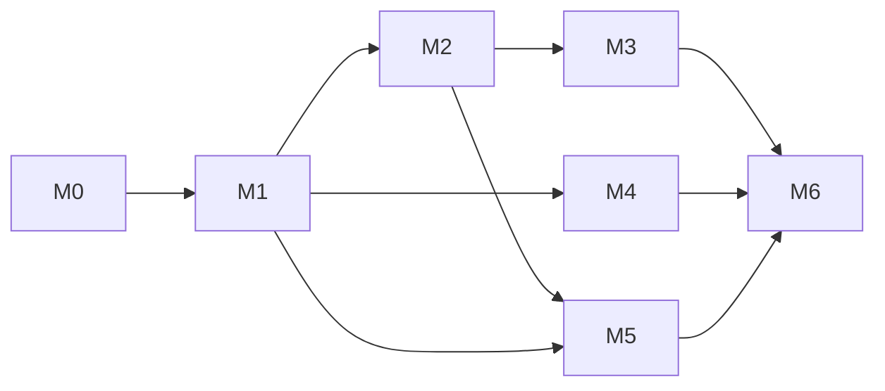

# cgbot Milestone

更新日期:2026-10-30。本文记录讨论确认的大方向;能力规划不代表功能已实现。当前**没有任何代码**,全部处于文档阶段。
设计事实来源:[DESIGN.md](DESIGN.md)。

## 三层工作流

**Milestone → Roadmap → TODO → 执行与验证 → 回填 Roadmap → 验收 Milestone。**

| 层级 | 回答的问题 | 组织方式 |
| --- | --- | --- |
| Milestone(Phase) | 达到什么结果 | 本文维护全局目标、依赖和状态 |
| Roadmap(Step) | 哪些能力构成结果 | 每个 Milestone 一份文档,每条能力有依赖与验收条件 |
| TODO | 当前条目如何执行 | 每个准备执行的 Roadmap 条目一份文档,拆成可核验任务 |

- 入口:[文档库](README.md)、[Roadmap 索引](ROADMAP.md)、[TODO 索引](todos/README.md)。
- 状态词:规划中、待决策、可执行、进行中、待验收、已完成。
- TODO 勾选完成后,仍需核对 Roadmap 条目的验收条件并记录证据。范围变化先更新上层,再调整下层。
- M6 只有 Roadmap,实施前复核范围并拆分 TODO。未创建 TODO 不表示能力被取消。

## 大方向

| 编号 | 方向 | 交付结果 | 主要依赖 | 当前状态 |
| --- | --- | --- | --- | --- |
| M0 | 基线与决策收束 | DESIGN.md 中的待答问题清零,关键外部假设(上游 Responses、NapCat 输入状态)经验证;工程约定(Python 版本、依赖管理、配置格式、目录、测试)确定 | 现有 DESIGN.md | R0.1、R0.2 待验收 |
| M1 | 核心骨架 | 配置驱动;NapCat 反向 WS 收发;身份与入口;追加式会话存储;供应商抽象;Agent 循环与 `reply` 工具;调度器与系统事件队列;范围白名单内的好友私聊可用 | M0 | 进行中 |
| M2 | 私聊体验 | 输入状态 5 秒等待;运行中新消息注入/打断;50% 窗口压缩与 8 小时空闲主动压缩;推理档位;记忆本(私聊域) | M1 | 规划中 |
| M3 | 群聊子系统 | @+关键词唤醒、睡眠时段静默、随机主动回话、72 小时静音、群会话生命周期与结束工具、群 SKILL 与群聊画像 | M1、M2 的记忆本 | 规划中 |
| M4 | 语音 | ASR/TTS 客户端(不改服务端)与语音媒体转换 | M1 | 规划中 |
| M5 | Coding Agent | Codex 替代 DSH:gateway 透传 Responses、沙盒镜像、manager、`codex_*` 与 `omp_*` 工具、大文件回传、Playwright 持久化 | M1、M2 的队列/事件机制 | 规划中 |
| M6 | 后置与上线 | 微信 OpenClaw、通知路由与最常用入口、旧功能取舍迁移、切换上线 | M1–M5 | 规划中,实施前拆分 |

## 依赖关系

M3 与 M4、M5 在 M2 之后可并行推进独立条目。
